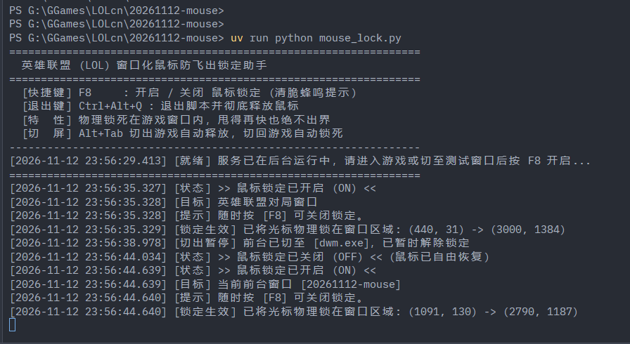
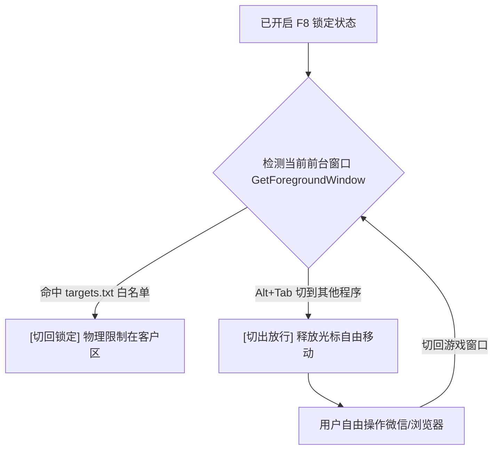

# 🎯 窗口化游戏鼠标防飞出锁定助手 (Games Window Mouse Lock)

针对 Windows 11 / Windows 10 小窗口/无边框模式玩竞技游戏时，因剧烈甩动鼠标导致光标飞出窗口、点击失焦痛点设计的轻量辅助工具。

> **💡 项目起源与诞生动机**
>
> 本项目最初诞生于 Windows 11 下窗口化玩《英雄联盟》的真实切肤之痛：在团战激烈甩动鼠标推镜头时，光标偶尔会直接“穿透”游戏窗口边缘点到桌面或其他后台软件上，瞬间造成游戏窗口失焦、操作完全断层。
>
> 游戏自身的边缘限制逻辑在面对高回报率（1000Hz+）电竞鼠标的单帧大幅度物理位移时容易出现判定穿透。为此，我们直接利用 Windows 操作系统内核级的原生系统调用（`ClipCursor`），在操作系统底层将光标物理锁死在游戏客户区内。
>
> 随着架构演进与多进程白名单机制的引入，本项目**起源于英雄联盟，但绝不限于英雄联盟**——现已全面支持《我的世界 Minecraft》、《CS2》、《无畏契约》、《永劫无间》以及各类模拟器等所有在窗口化/无边框模式下存在鼠标飞出困扰的 PC 游戏。

---

## 📸 运行效果演示



---

## ✨ 核心特性

1. **底层物理锁死**：直接调用 Windows 原生 `ClipCursor` API，光标在操作系统底层被强行限制在游戏画面客户区内，**甩得再快也绝不可能跨过边界**。
2. **纯原生零依赖**：基于 Python 标准库（`ctypes` + `winsound`），不需要安装任何额外第三方 pip 库，开箱即用。
3. **双调清脆提示音**：
   * **开启锁定 (ON)**：清脆双升调蜂鸣（*哔哔*）
   * **关闭锁定 (OFF)**：降调长音（*嘟——*）
4. **智能前台跟随**：开启锁定后，若使用 `Alt + Tab` 切到微信或网页，脚本会**自动临时释放鼠标**；切回游戏又会**自动重新锁死**，无需反复手动开关。
5. **多进程白名单与热重载**：支持通过同目录下的 `targets.txt` 自定义保护进程（支持《英雄联盟》、《我的世界 Minecraft》、《CS2》等任意窗口化游戏），改动文件即时生效，无需重启脚本。
6. **三重加固防误锁**：严格校验目标进程名、对局窗口类名与最小有效尺寸，彻底杜绝大厅或小浮窗误锁。
7. **高精度对称式毫秒日志**：切入切出成对记录，毫秒级时间戳清晰可查。
8. **安全退出机制**：无论按快捷键退出还是关闭控制台，均有退出钩子确保 `ClipCursor(NULL)` 100% 释放鼠标，绝不残留。

---

## 🚀 启动方式

进入目录后，使用 `uv run` 或 `python` 直接运行：

```bash
cd /d G:\GGames\LOLcn\20261112-mouse

# 推荐使用 uv run
uv run python mouse_lock.py

# 或者直接用系统 python
python mouse_lock.py
```

---

## 📋 目标进程白名单与热重载 (`targets.txt`)

同目录下的 `targets.txt` 支持添加你想保护的任意窗口化游戏。**修改保存后脚本会自动热加载生效，无需重启**：

```text
# 英雄联盟 League of Legends (对局核心游戏主进程)
League of Legends.exe

# 我的世界 Minecraft (Java版 / Windows基岩版，需要时去掉前面的 #)
# javaw.exe
# Minecraft.Windows.exe

# 其它竞技游戏参考预留 (需要时去掉前面的 #)
# cs2.exe
# VALORANT-Win64-Shipping.exe
# NarakaBladepoint.exe
# StarCraft.exe
```

---

## ⌨️ 快捷键说明

| 快捷键 | 作用 | 说明 |
| :--- | :--- | :--- |
| **`F8`** | **开启 / 关闭 鼠标锁定** | 英雄联盟等竞技游戏内默认无任何冲突的顺手按键，单手随时一键切换。 |
| **`Ctrl + Alt + Q`** | **安全退出脚本** | 退出程序并彻底恢复全局光标。也可在终端直接按 `Ctrl + C`。 |

> 提示：如果想更换快捷键（如改成 `F7` 或其他键），直接打开 [mouse_lock.py](file:///G:/GGames/LOLcn/20261112-mouse/mouse_lock.py) 修改顶部的 `HOTKEY_VK` 即可。

---

## 🔬 脚本核心工作原理深度解析

这个脚本之所以能够做到**甩得再快也绝不失焦、不卡顿帧率、进退自如**，是因为它直接调用了 Windows 最底层的内核级交互接口：

### 🧱 1. 核心底层：Windows 的“光标物理围栏” (`ClipCursor`)
整个程序最关键的调用来自于 Windows `user32.dll` 提供的 Win32 API：
```python
user32.ClipCursor(rect)
```
* **上锁原理（画地为牢）**：
  * 向 API 传入一个由屏幕物理像素确定的矩形范围 `[left, top, right, bottom]`（例如从 `(200, 150)` 到 `(1800, 1050)`）。
  * 该指令会直接提交给 Windows 内核的**光标管理器 (Cursor Manager)**。
  * 操作系统在处理高回报率鼠标（如 1000Hz/4000Hz）发出的物理位移中断时，会在系统驱动层强行将指针坐标**钳位 (Clamp)** 在设定的矩形内。
  * **结论**：这不是靠脚本去“把鼠标拉回来”，而是系统层认定“围栏之外的屏幕空间对鼠标不存在”，因此单帧物理跨越再大也不会穿透出界。
* **解锁原理（撤掉围栏）**：
  * 向 API 传入 `None`（即 C 语言的 `NULL`）：
    ```python
    user32.ClipCursor(None)
    ```
  * Windows 光标管理器收到后立刻清空约束，光标瞬间恢复全屏和多显示器自由移动。

---

### 📐 2. 精准定位：锁定游戏客户区而非整个窗口
如果直接获取游戏窗口的外边框，鼠标可能会移动到标题栏或关闭按钮上。脚本进行了两步精密换算：
1. **获取客户区尺寸 (`GetClientRect`)**：仅抓取对局画面实际渲染的区域尺寸，剥离 Windows 边框和标题栏，获取纯净画面宽高（如 `1600 x 900`）。
2. **物理坐标映射 (`ClientToScreen`)**：窗口在屏幕上的摆放位置是任意的，脚本通过坐标映射将画面四个顶点换算为显示器上的绝对物理像素坐标，从而实现像素级的严丝合缝。

---

### ⚡ 3. 抗拦截按键监听：硬件异步状态查询 (`GetAsyncKeyState`)
许多全屏/独占游戏会吃掉常规的全局热键消息（Message Hook）。脚本采用了更底层的查询方案：
* **查询接口**：`user32.GetAsyncKeyState(0x77)`（`0x77` 为 F8 键的虚拟键码）。
* **工作方式**：脚本主动向操作系统查询硬件层面上该物理按键此刻是否处于按下状态，无视游戏窗口的焦点独占和消息吞吐。
* **边沿触发机制 (Edge Trigger)**：维护前一帧按键状态，只在按键**从未按下跃迁为按下（上升沿）**的瞬间翻转一次锁定开关，避免长按时触发高频开关抖动。

---

### 🔄 4. 智能切屏跟随与对称式日志
开启锁定后，完全无需在切屏时手动按 F8：



* **对称日志范例**：
  ```text
  [2026-11-13 00:37:24.416] [切回锁定] 前台已切至 [League of Legends.exe]，命中目标进程，已锁定区域: (440, 31) -> (3000, 1384)
  [2026-11-13 00:37:26.081] [切出放行] 前台已切至 [Zed.exe]，非目标进程，已暂时释放鼠标
  ```

---

### 🛡️ 5. 双重安全防呆机制（绝不卡死鼠标）
针对“脚本异常崩溃导致鼠标被困住”的担忧，代码内置了双重保障：
```python
atexit.register(release_mouse)  # 解释器退出钩子
try:
    ...
finally:
    release_mouse()             # 强行中断/未捕获异常最终保障
```
无论是主动按 `Ctrl + Alt + Q` 退出、终端按 `Ctrl + C`，还是任务管理器强杀进程，都会触发释放钩子调用 `ClipCursor(None)`，100% 保证退出即恢复自由。

---

## 🎵 提示音的“来头”与声学设计

脚本中的提示音不仅为了好听，在**底层实现**与**听觉心理学（交互声效）**上均有专门设计：

### 🏛️ 1. 底层技术来头：Windows 最古老的蜂鸣接口
* **原生 API**：调用 Python `winsound.Beep(frequency, duration)`，底层直接映射自 Windows 系统内核库 `kernel32.dll` 的 `Beep(dwFreq, dwDuration)`。
* **历史渊源**：源自早期 IBM PC / DOS 时代的 PC 主板微型压电蜂鸣器（开机自检“滴”声的来源）。在现代 Windows 系统中，微软将其接入音频引擎，通过声卡算法直接实时合成**纯净正弦波**。
* **核心优势**：**零文件依赖、零启动延迟、零额外内存**。不需要在磁盘加载 `.wav` 或 `.mp3` 音频文件，不会因音频解码导致游戏出现微掉帧。

### 🧠 2. 音调心理学设计（Psychoacoustics）
* **锁定开启（ON）：`1200Hz (70ms) -> 1800Hz (100ms)`**
  * **设计特征**：短促双音、音高快速爬升（跨越近纯五度音程，从高音 D6 跳至 A6）。
  * **心理暗示**：属于人机交互中最经典的**“确认/激活音 (Confirmation Chime)”**（类似于雷达开机、机甲护盾充能或高端鼠标切档音），传达**“防御就绪、进入战斗状态”**的积极反馈。
* **锁定解除（OFF）：`700Hz (130ms)`**
  * **设计特征**：单一中低频音（接近中音 F5），时长略长且平缓。
  * **心理暗示**：属于经典的**“释放/归位音 (Deactivation)”**，给大脑传递**“限制已解除、光标已自由”**的放松信号，无需看屏幕即可确认可安心切屏。

---

## 🧪 验证与测试

1. 启动脚本后，直接在当前任意小窗口（如记事本、浏览器或游戏客户端）按一下 **`F8`**，听到“哔哔”声后，鼠标就会进入锁定就绪状态。
2. 切入在 `targets.txt` 中的游戏窗口，光标会被物理锁定在窗口内部，用力甩动也无法越界。
3. 按 `Alt + Tab` 切到其他软件，光标自动解除限制；切回游戏自动恢复锁定。
4. 再按一下 **`F8`**，听到“嘟——”声，锁定彻底关闭。
